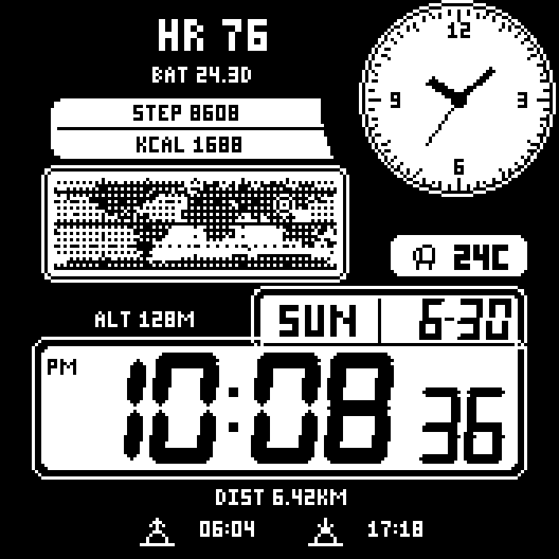
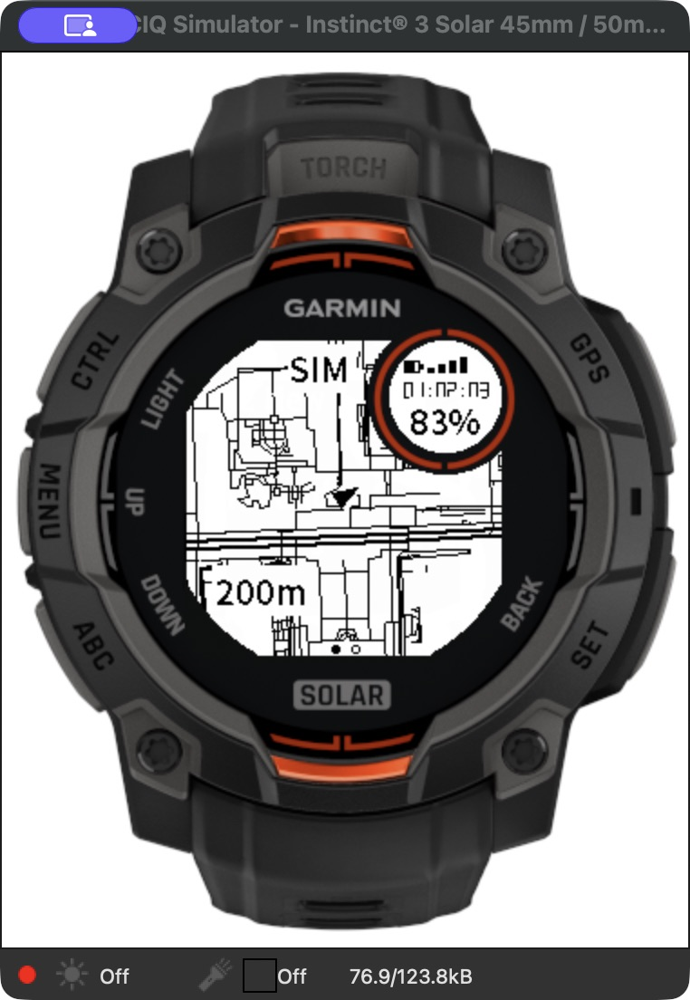

# WristInk · 腕上墨迹

**为 Garmin 手表打造的表盘与离线工具集。**

从一眼读清的数据表盘，到会随昼夜变化的世界地图，再到腕上的北京离线导航。WristInk 聚焦 MIP 屏幕、原生像素资源和手表本地能力，当前包含两个表盘和一个独立应用，使用 Monkey C / Connect IQ 开发。

## 项目一览

| 项目 | 类型 | 主要功能 | 设备范围 |
| --- | --- | --- | --- |
| [墨刻 Moke](moke/) | 数据表盘 | 大字时间、可配置数据区、当前心率与曲线、中英文、主题与装饰卡片 | 清单内的 Garmin MIP 机型，含轻量兼容实现 |
| [Retro World](retro-world/) | 世界地图表盘 | 复古数字、模拟圆盘、16 种地图皮肤、昼夜变化、天气、日出日落 | Instinct 3 Solar 45 / 50 mm |
| [北京离线地图](beijing-map/) | 独立手表应用 | 离线地图、地点搜索、步行路线、GPS 跟随、轨迹记录、手表数据页 | Instinct 3 Solar 45 / 50 mm |

设备清单表示构建目标，不代表所有型号均已完成真机验证。两个 Instinct 3 Solar 尺寸使用 SDK 中的同一构建目标 `instinct3solar45mm`。

## 画面预览

| 墨刻 | Retro World | 北京离线地图 |
| :---: | :---: | :---: |
|  |  |  |

以上为演示预览、离线设计图和带 SIM 标记的模拟器截图，不代表实表测量数据。

## 墨刻 · 百变数据表盘

- 粗体大时间与多个可配置数据区，提供 94 项设置、28 种数据选项。
- 支持简体中文和英文、12/24 小时制、黑白主题、字体及字号调整。
- 展示当前心率、心率曲线、步数、热量、海拔、天气和续航等数据；具体能力随设备而异，缺失数据使用占位符。
- 本能 3 专用图标、月相、方向箭头和右上心率窗，配合原生分辨率位图字体。
- 20 种装饰卡片、卡片与秒数切换，以及不同数据刷新策略。
- 为旧接口和低内存机型提供轻量兼容实现；读取系统天气缓存，不主动启动 GPS。

装饰卡片仅为图案，没有公交、门禁或支付功能。详见 [墨刻开发说明](moke/README.md)。

## Retro World · 世界地图表盘

- 复古数字与右上模拟表盘，保留单色像素风格。
- 基于 Natural Earth 陆地轮廓的世界地图，提供 16 种皮肤，并按本地天气、昼夜和晨昏选择。
- 世界昼夜底纹随时间变化，显示近似位置、天气、日出日落。
- 显示心率、电量预计天数、步数、热量、海拔和距离等指标。
- 数字秒数与秒针在抬腕唤醒期间走动，待机冻结；地图与环境数据使用低频缓存。

世界地图用于表盘展示，不提供导航。详见 [功能、数据和安装说明](retro-world/README.md)。

## 北京离线地图 · 腕上步行工具

- 内置北京 OSM 地图资源，支持地图缩放、平移和十六区切换。
- 约 9.2 万条地点、道路和部分地址记录，支持完整拼音前缀检索。
- 在手表上计算步行推荐路线，支持目的地恢复、离线重算和偏离提示。
- GPS 跟随、方向显示、轨迹保存与恢复，并通过 Garmin FIT 接口记录活动。
- 地图与数据双页，显示时间、心率、步数、距离、电量和记录计时。

分层路线不保证最短，地点覆盖也不是完整门牌库；目前没有实时路况、转弯语音或偏离后自动重算。真机 GPS、罗盘、FIT 内容及长期耗电仍需实测。详见 [操作、范围与限制](beijing-map/README.md)。

## 目录结构

```text
wristink/
├── moke/                    # 墨刻表盘
│   ├── source/              # Monkey C 源码
│   ├── resources/           # 基础资源
│   ├── resources-eng/       # 英文资源
│   ├── assets/              # 字体源文件等
│   ├── config/              # 布局、设置和设备配置
│   ├── scripts/             # 生成、构建和验证脚本
│   └── tests/               # SDK 测试
├── retro-world/             # Retro World 表盘
│   ├── source/
│   ├── resources/
│   ├── assets/
│   ├── tools/
│   └── tests/
├── beijing-map/             # 北京离线地图应用
│   ├── source/
│   ├── resources/           # 编译必需的地图、搜索与路网资源
│   ├── data/README.md       # 原始数据获取和重建说明
│   ├── tools/
│   └── tests/
├── docs/images/             # 项目预览
├── THIRD_PARTY_NOTICES.md
└── instinct.code-workspace  # 三项目 VS Code 工作区
```

每个项目都有独立的 `manifest.xml` 与 `monkey.jungle`。本机主目录仍可命名为 `instinct`，不影响 GitHub 仓库名和项目间的相对路径。

## 开发与构建

当前脚本面向 **macOS + zsh、Connect IQ SDK 9.2、JDK 19、Python 3**。Java 默认路径写在构建脚本中，其他环境需要按实际安装位置调整。通过 Garmin SDK Manager 安装 SDK 和目标设备，并将 SDK 的 `bin` 目录加入 `PATH`，使 `monkeyc`、`monkeydo` 可用。

使用自己的开发者签名密钥，当前脚本读取 `~/.Garmin/keys/developer_key.der`。密钥不包含在仓库内。VS Code 的 Java 和签名密钥路径请放在个人设置中。

```sh
git clone https://github.com/jiayibyte/wristink.git
cd wristink
python3 -m venv .venv
source .venv/bin/activate
python -m pip install -r requirements.txt

# 墨刻：生成必要资源并构建 Instinct 3 专项包
zsh moke/scripts/build-instinct3.sh 1.1.0

# Retro World：生成资源并构建正式、演示与商店包
zsh retro-world/tools/build.sh

# 北京离线地图：直接使用仓库内已打包的地图资源编译
zsh beijing-map/tools/build.sh
```

墨刻的 `generated/` 设备派生资源不纳入 Git；全 MIP 目标构建前需要对应设备包，详见 [墨刻说明](moke/README.md)。北京地图仅在更新数据时需要额外的数据处理依赖，见 [数据说明](beijing-map/data/README.md)。

构建产物输出在各项目的 `bin/`、`dist/` 中；这些目录、旧发布包、模拟器缓存和本机商店后台材料均不纳入 Git。部分历史回归和打包脚本依赖此前的发布包或运行日志，干净克隆并不包含这些历史证据。

## 数据与许可

字体、Natural Earth 和 OpenStreetMap 数据的来源与许可见 [第三方声明](THIRD_PARTY_NOTICES.md)。请保留各资源原有的许可和署名。项目与 Garmin 无隶属关系。

编译成功、模拟器运行和真机验证是不同阶段；本仓库不据此承诺全机型行为或固定续航。
