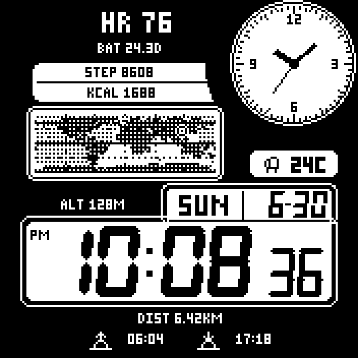
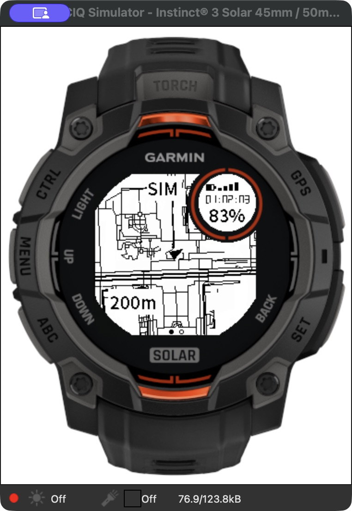

# WristInk · 腕上墨迹

**为 Garmin 手表打造的表盘与离线工具集。**

从一眼读清的数据表盘，到会随昼夜变化的世界地图，再到腕上的北京离线导航。WristInk 聚焦 MIP 屏幕、原生像素资源和手表本地能力，各项目使用 Monkey C / Connect IQ 开发。

## 项目一览

| 项目 | 类型 | 主要功能 | 设备范围 |
| --- | --- | --- | --- |
| [墨刻 Moke](moke/) | 数据表盘 | 圆角大时间、可配置数据区、当前心率与曲线、中英文、6 套彩色配色与装饰卡片 | 147 个 SDK 目标：MIP（含轻量兼容实现）、AMOLED 与 LCD |
| [寰游时刻 Retro World](retro-world/) | 世界地图表盘 | 复古数字、模拟圆盘、16 种地图皮肤、昼夜变化、天气、日出日落、AMOLED 配色与常亮 | 112 个 SDK 目标 / 183 硬件变体，具体见项目兼容清单 |
| [Tide Grid](tide-grid/) | 潮汐数据表盘 | 港口潮汐、日出日落、步数与心率图、三种时间字体、Instinct 实体圆窗 | 以 fēnix／epix 为主，覆盖彩屏 MIP、AMOLED 和单色 Instinct |
| [Signal LCD](signal-lcd/) | 复古数字表盘 | 七段数字、可配置数据区、14 套彩屏主题、Instinct 实体圆窗 | 圆形彩屏和支持的单色 Instinct／Descent |
| [北京离线地图](beijing-map/) | 独立手表应用 | 离线地图、地点搜索、步行路线、GPS 跟随、轨迹记录、手表数据页 | Instinct 3 Solar 45 / 50 mm |

设备清单表示构建目标，不代表所有型号均已完成真机验证。两个 Instinct 3 Solar 尺寸使用 SDK 中的同一构建目标 `instinct3solar45mm`。

## 画面预览

| 墨刻 | Retro World | 北京离线地图 |
| :---: | :---: | :---: |
|  |  |  |

以上为演示预览、离线设计图和带 SIM 标记的模拟器截图，不代表实表测量数据。

## 墨刻 · 百变数据表盘

- 粗体大时间与多个可配置数据区，提供 95 项设置、28 种数据选项。
- 支持简体中文和英文、12/24 小时制、黑白主题、字体及字号调整。
- 彩色屏（彩色 MIP、AMOLED、LCD）提供 6 套配色：经典黑白、琥珀（默认）、冰川、薄荷、夜光、樱花；主时间保持白色，图标、进度、趋势线和秒数随配色变化。单色屏不受影响。
- AMOLED 低功耗时只显示小号时间和日期并每分钟微移，右上心率窗默认黑底。
- 展示当前心率、心率曲线、步数、热量、海拔、天气和续航等数据；具体能力随设备而异，缺失数据使用占位符。
- 本能 3 专用图标、月相、方向箭头和右上心率窗，配合原生分辨率位图字体。
- 20 种装饰卡片、卡片与秒数切换，以及不同数据刷新策略。
- 为旧接口和低内存机型提供轻量兼容实现；读取系统天气缓存，不主动启动 GPS。

装饰卡片仅为图案，没有公交、门禁或支付功能。详见 [墨刻开发说明](moke/README.md)。

## 寰游时刻 Retro World · 世界地图表盘

- 复古数字与右上模拟表盘；MIP 保留黑白像素风格，AMOLED 使用暖白、青绿与琥珀点缀。
- 基于 Natural Earth 陆地轮廓的世界地图，提供 16 种皮肤，并按本地天气、昼夜和晨昏选择。
- 世界昼夜底纹随时间变化，显示近似位置、天气、日出日落。
- 显示心率、电量预计天数、步数、热量、海拔和距离等指标。
- 可配置数据区与独立 12/24 小时制；支持的 MIP 机型持续局部刷新心率、数字秒数和秒针，AMOLED AOD 按分钟更新。地图与环境数据使用低频缓存。

世界地图用于表盘展示，不提供导航。详见 [功能、数据和安装说明](retro-world/README.md)。

## 截图复现技能

[garmin-watchface-replica](skills/garmin-watchface-replica/SKILL.md) 整理两款表盘的原生字体、像素布局、设备适配、资源来源、内存与省电经验，并提供像素对照和字形检查脚本。

它将视觉还原与技术兼容分开验收，不把当前表盘当作审美终版。现状与下一轮优化重点见 [两款表盘复盘](docs/watchface-replication-review.md)。

## 北京离线地图 · 腕上步行工具

- 内置北京 OSM 地图资源，支持地图缩放、平移和十六区切换。
- 约 9.2 万条地点、道路和部分地址记录，支持完整拼音前缀检索。
- 在手表上计算步行推荐路线，支持目的地恢复、离线重算和偏离提示。
- GPS 跟随、方向显示、轨迹保存与恢复，并通过 Garmin FIT 接口记录活动。
- 地图与数据双页，显示时间、心率、步数、距离、电量和记录计时。

分层路线不保证最短，地点覆盖也不是完整门牌库；目前没有实时路况、转弯语音或偏离后自动重算。真机 GPS、罗盘、FIT 内容及长期耗电仍需实测。详见 [操作、范围与限制](beijing-map/README.md)。

## 目录结构

```text
wristink/
├── moke/                    # 墨刻表盘
│   ├── source/              # Monkey C 源码
│   ├── resources/           # 基础资源
│   ├── resources-eng/       # 英文资源
│   ├── assets/              # 字体源文件等
│   ├── config/              # 布局、设置和设备配置
│   ├── scripts/             # 生成、构建和验证脚本
│   └── tests/               # SDK 测试
├── retro-world/             # Retro World 表盘
│   ├── source/
│   ├── resources/
│   ├── assets/
│   ├── tools/
│   └── tests/
├── beijing-map/             # 北京离线地图应用
│   ├── source/
│   ├── resources/           # 编译必需的地图、搜索与路网资源
│   ├── data/README.md       # 原始数据获取和重建说明
│   ├── tools/
│   └── tests/
├── docs/images/             # 项目预览
├── THIRD_PARTY_NOTICES.md
└── instinct.code-workspace  # 三项目 VS Code 工作区
```

每个项目都有独立的 `manifest.xml` 与 `monkey.jungle`。本机主目录仍可命名为 `instinct`，不影响 GitHub 仓库名和项目间的相对路径。

## 开发与构建

当前脚本支持 **macOS 和 Linux（zsh、Connect IQ SDK 9.2+、JDK 17+、Python 3）**。通过 Garmin SDK Manager 安装 SDK 和目标设备即可，脚本通过 [`tools/ciq_env.sh`](tools/ciq_env.sh) / [`tools/ciq_env.py`](tools/ciq_env.py) 自动找到当前 SDK、设备包和 Java：

- SDK Manager 数据目录：macOS 为 `~/Library/Application Support/Garmin/ConnectIQ`，Linux 为 `~/.Garmin/ConnectIQ`，Windows 为 `%APPDATA%\Garmin\ConnectIQ`；可用 `CIQ_HOME`、`CIQ_SDK`、`CIQ_DEVICES` 覆盖。
- Java：macOS 上存在 `jdk-19` 时沿用它，否则使用 `JAVA_HOME` 或 `PATH` 中的 `java`。编译器默认堆上限放宽到内存的 70%（山境单机型编译约需 11 GB），可用 `JAVA_TOOL_OPTIONS` 覆盖。山境商店包只在 epix2 上做一次完整类型检查，全量导出跳过重复推断（`-l 0`，产物逐字节相同），15 GB 内存的 Linux 上约 8 分钟。
- 7-Zip：检查和打包 `.iq` 依次使用 `7zz`、`7z` 或 `7za`（macOS：`brew install sevenzip`；Linux：`sudo apt install p7zip-full`）。
- 预览图中文字体：macOS 用华文黑体；Linux 需安装 Noto CJK（如 `sudo apt install fonts-noto-cjk`）。
- Ubuntu 24.04 上 SDK Manager 和模拟器需要 WebKitGTK 4.0（`libwebkit2gtk-4.0-37`），该版本需从 Ubuntu 22.04 软件源获取。

使用自己的开发者签名密钥，当前脚本读取 `~/.Garmin/keys/developer_key.der`（可用 `CIQ_KEY` 覆盖）。密钥不包含在仓库内。VS Code 的 Java 和签名密钥路径请放在个人设置中。

```sh
git clone https://github.com/jiayibyte/wristink.git
cd wristink
python3 -m venv .venv
source .venv/bin/activate
python -m pip install -r requirements.txt

# 墨刻：生成必要资源并构建 Instinct 3 专项包
zsh moke/scripts/build-instinct3.sh 1.2.0

# Retro World：生成资源并构建正式、演示与商店包
zsh retro-world/tools/build.sh

# 北京离线地图：直接使用仓库内已打包的地图资源编译
zsh beijing-map/tools/build.sh
```

墨刻的 `generated/` 设备派生资源不纳入 Git；全 MIP 目标构建前需要对应设备包，详见 [墨刻说明](moke/README.md)。北京地图仅在更新数据时需要额外的数据处理依赖，见 [数据说明](beijing-map/data/README.md)。

构建产物输出在各项目的 `bin/`、`dist/` 中；这些目录、旧发布包、模拟器缓存和本机商店后台材料均不纳入 Git。部分历史回归和打包脚本依赖此前的发布包或运行日志，干净克隆并不包含这些历史证据。

## 数据与许可

字体、Natural Earth 和 OpenStreetMap 数据的来源与许可见 [第三方声明](THIRD_PARTY_NOTICES.md)。请保留各资源原有的许可和署名。项目与 Garmin 无隶属关系。

编译成功、模拟器运行和真机验证是不同阶段；本仓库不据此承诺全机型行为或固定续航。
