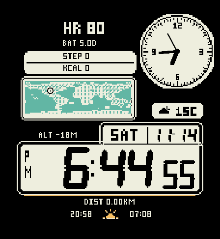

# 三款已上线表盘反馈排查 · 2026-11-14

本轮查询国际区与中国区公开页（国际区复用现有开发者登录），检查所有可见历史评论。观察时两区当前版本一致：Moke 1.2.0、Retro World 2.1.1、Alpine 1.0.0。共 16 条文字评论；中国区 Moke 显示 6 个评分但只有 5 条文字评论。下载量按商店区间保留，不能相加推算独立用户。

## 反馈及处理状态

| 应用/地区 | 评论与版本 | 问题/建议 | 本轮结果 |
| --- | --- | --- | --- |
| Moke 中国 | 张政毅，11-14，1.2.0 | 参数改不了 | 未稳定复现，不能标为已修复 |
| Moke 中国 | 星星，11-07，1.2.0 | 参数不能改 | 同上 |
| Moke 国际 | Paolo，11-04，1.2.0；Leo Vasquez，11-03，1.1.1 | 设置/背景不能保存，Leo 使用 Instinct 3 Solar | 本地菜单改主题并返回可生效；Kill App 后同测试 ID 重启保留。官方设置编辑器保存后，日志确认 onSettingsChanged 收到 true，应用重画为深色。初次编辑器尝试未立即更新，后续带日志尝试未能稳定复现故障。没有真机证据，未改写运行代码 |
| Moke 中国 | 勇敢大牛牛，11-04；refraining.，11-03；21038，11-02，均针对 1.0.0 | 本能 2X 战术版/本能无法使用或 IQ | 评论早于当前 1.2.0；型号、地区固件和触发步骤不足，仍待定位，不因新版已有兼容保护便声称真机恢复 |
| Moke 国际 | Cristi，11-01，1.1.0 | 英文支持 | 当前 1.2.0 已有英文与默认英文回退；本次英文正式数据模拟器菜单、表盘及设置元数据可见英文，没有重复开发 |
| Retro World 国际 | Andrei，11-11，2.1.1，Venu Sq | 短暂正常，随后只剩秒数和心率 | 确认代码在同一分钟跳过整帧，只更新两处动态区域。修改完整回调为重画全屏，独立保留数据缓存；对应原生回归通过。尚无评论者真机复核 |
| Retro World 中国 | 梁亚飞，11-07，2.1.1，本能 2 | 返回表盘后圆窗延迟显示 | 同分钟完整帧重画；将图形缓存有效性检查扩展至 MIP，丢失后完整回调恢复。局部回调不承担缓存重建。对应原生回归通过，真机延迟改善未测量 |
| Retro World 中国 | Ma GL，11-12，2.1.1，本能 2 | 仅抬腕刷新时，希望休眠隐藏数字秒数 | 已实现：睡眠申请整帧，省略数字秒数，唤醒恢复；持续刷新模式保留。原生行为测试通过，实际低功耗 UI 调度补测受阻 |
| Retro World 中国 | 21038，11-02，2.0.0 | 本能日出日落不显示 | 旧区域 API 的 NOAA 回退已存在。新增位置回退：天气超过 3h 时仍不显示过期天气，但可用 7 天内最后已知 GPS/天气位置计算太阳时间，选择较新来源；未来/过旧/非法坐标仍拒绝。原生回归覆盖边界。可能显示上次所在地的太阳时间，旅行后应更新定位；无位置或极昼极夜仍显示占位符 |
| Retro World 国际 | Bubu，11-08，2.1.1，Forerunner 55 | 无法使用 | 编译及 28 项原生测试通过。首次真实数据启动因模拟器无响应没有日志；清理并重启模拟器后，正式数据场景成功启动，日志有 REFRESH_FRAME 且原生窗口完整显示表盘。未复现具体故障；缺少真机固件及故障形态，仍不能声称原评论已解决 |
| Retro World 国际 | אדורם，10-29，2.0.0，Venu X1 | 无法使用 | 当前修复源码的正式数据独立场景已启动并保存完整画面。完整测试首次在旧用例中超时，后续连接曾无日志超时；清理并重启模拟器后，最终完整 28 项套件通过。不宣称原评论真机故障已解决 |
| Retro World 国际/中国 | Dave，10-29，2.0.0；jiayi，11-01，2.0.0 | 好评 | 无代码缺陷；国际区已有回复，未重复发布 |
| Alpine 两区 | 1.0.0 | 均无评论 | 没有据评论修改代码 |

## 验证

- 最终修复源码导出：SDK 9.2.0，112 个目标、183 个硬件变体，成功。
- 183 个变体各 21 项设置、默认值和中英文元数据校验通过。
- Garmin SDK `VerifyingUtils.verifyIqFile` 验证包签名及全部产品签名通过。
- Forerunner 55、Venu Sq、本能 2、Venu X1 各 28 项 Monkey C 原生测试通过，包括同一分钟恢复完整静态内容、仅抬腕休眠省略秒数、局部预算降级、天气与位置有效期分离。日志保存在 evidence。
- 早期 Venu X1 套件及部分真实数据场景受模拟器空白/无响应影响。保留超时与空日志，最终 Venu X1 套件在干净重启后通过；不把空日志归因于产品崩溃。
- 清理并重启模拟器后，Forerunner 55 正式数据补验成功，见 `evidence/fr55-live-retry.log`；原生窗口完整显示表盘，无 IQ 图标。
- Venu X1 正式数据场景完整画面见下图。图中健康与位置等值来自本机模拟器缓存，不是真人手表测量。
- 资源生成器重写的 51 张 PNG 均核对像素相同，仅压缩字节不同，已撤销 Git 噪声差异。
- Moke 本轮没有运行时代码修改；设置验证局限见 `evidence/moke-settings-observations.json`。
- 没有实表续航、实体机恢复或商店公开可更新的证据。完整回调重画增加唤醒期间的绘图工作，数据与地图读取仍保留缓存，功耗不能由模拟器外推。

## 本地交付

候选包：`retro-world/dist/RetroWorld-2.1.2.iq`。

SHA-256：`1cae628bd3b536be86d6cab4b3814d73a43c2fbd39129b1670ff5ddb7779bc4a`。

当前仅本地候选，未上传、未回复评论、未创建 MR、未推送远端。它不是所有真机反馈均已解决的正式发布声明。详情见 `store-snapshot.json`、`evidence/package.json` 与每项原始日志。

商店来源：[Moke 国际](https://apps.garmin.com/apps/08e3601d-b0b1-451a-a390-67543e39ae02)、[Moke 中国](https://apps.garmin.cn/apps/08e3601d-b0b1-451a-a390-67543e39ae02?tid=2)、[Retro World 国际](https://apps.garmin.com/apps/76e1c5f4-abe8-49ab-bcc0-44c2b1c1a267)、[Retro World 中国](https://apps.garmin.cn/apps/76e1c5f4-abe8-49ab-bcc0-44c2b1c1a267?tid=2)、[Alpine 国际](https://apps.garmin.com/apps/8fdd0374-78f0-4452-bfd7-9bfa9c1229eb)、[Alpine 中国](https://apps.garmin.cn/apps/8fdd0374-78f0-4452-bfd7-9bfa9c1229eb?tid=2)。完整/局部刷新约定参考 [Garmin WatchFace 文档](https://developer.garmin.com/connect-iq/api-docs/Toybox/WatchUi/WatchFace.html)。

## 2026-11-14 商店提交结果

Retro World 2.1.2 已上传并完成详情 Submit，Garmin 文件及签名均为 Verified。重新打开详情页，28 种语言更新说明及原有标题全部持久保存。后台 Latest app version 与国际区公开 Version 均为 2.1.2（Internal: 4）。国际区新增两条开发者回复：Andrei 与 Bubu；已核验可见，原有五条回复保留。

中国区最后核对仍为 2.1.1。用户随后授权中国区登录；登录成功后，Retro World 与 Moke 评论页均只有“举报问题”操作，没有开发者回复控件；中国区 `/developer/dashboard` 返回首页。9 条回复保留为草稿，没有以普通用户评论冒充开发者回复，也没有把登录凭据写入文件。

Garmin 官方论坛的团队回复确认了国际区到中国区的商店同步机制及曾出现过的同步阻塞：[官方团队同步说明](https://forums.garmin.com/developer/connect-iq/f/discussion/269016/app-updates-not-synced-to-iq-store-chinese-version/1676061)。这不证明本次延迟必然是同一故障。当前登录页面没有回复入口，与开发者报告的中国区评论回复限制一致：[开发者一手报告](https://forums.garmin.com/developer/connect-iq/f/discussion/385879/releasing-a-version-with-bug-fixes-will-lower-the-ranking-of-the-watch-face)。

提交与回复证据见 `publication-status.json`、`publication-drafts.json` 和 `evidence/store-*.jpg`。上述提交状态取代前一节的“仅本地候选”状态；未定位的真机反馈仍不记为已解决。
