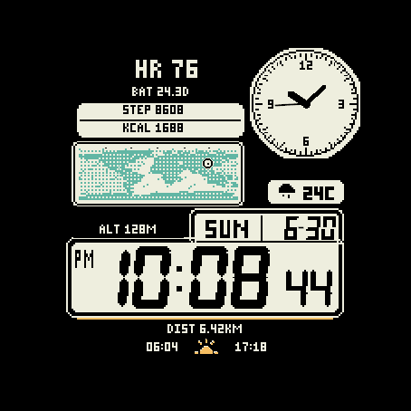

# 两款表盘的复现质量复盘

核对日期：2026-10-28。范围是 Moke 与 Retro World 的现有源码、资源生成方式和保存的预览/原生截图。本轮整理经验和提交源码，不擅自更换已发布表盘的字体或重新设计整张表盘。

| Moke已有设计预览（非本轮原生验收） | Retro World AMOLED原生截图 |
| --- | --- |
|  |  |

页面缩略图用于对照整体层级；判断像素结构时打开原图，不以浏览器缩放结果代替原生像素。

## 判断

当前功能和兼容性验证比视觉验收更完善。“看着像素感大”不只由屏幕分辨率造成，还包含字形母版、区域比例、笔画重量和适配策略的问题。保留用户喜欢的原字体，并不意味着只能放大旧位图；可以从同一母版按目标尺寸重新生成、修正格点与间距。

| 问题 | 观察/源码证据 | 下次复现的做法 |
| --- | --- | --- |
| 高分屏仍像放大的低分屏 | Retro World 的设备资源多数先转1-bit再最近邻缩放；AMOLED原生图可见粗台阶 | 主时间、圆弧和图标从母版重新生成；小字单独hinting。需要保持像素风时保留节奏，而不是全盘平滑 |
| 主时间很粗、副标签很细 | Retro World 主时间、BAT/ALT/DIST和边框的视觉重量差异大 | 固定主时间风格，单独调标签墨迹高度与线宽、区域留白；避免一律减小字号 |
| 密集刻度、点阵、双边框相互争夺注意力 | 地图点阵、钟面60刻度、日期和时间边框都占高对比面积 | 原样复现版先对齐；优化候选再在次要装饰上减密度，不擅自改参考主体 |
| 数据字形和图标重量不统一 | Moke预览有粗主时间、较细中文/数据与不同来源图标；字体族和字号配置较多 | 建立图标笔宽和文字视觉等级；对实际组合做整体验收，不能只逐个图标看 |
| 缩放通过但布局比例未必好看 | 统一逻辑坐标适合首轮适配，不能保证不同屏幕相同视觉效果 | 小型本能/圆屏MIP/圆屏AMOLED/长方屏分别指定字号、边距和信息密度 |
| AOD技术预算过关但视觉太碎 | 当前轮廓+像素轮休会形成点划线 | 在新版本中比较较小实心字、连续细线等候选；先看1×可读性，再检查亮屏与烧屏约束 |

Moke使用已有设计预览作本轮视觉参考，未重新取得所有机型的原生截图；不能据此断言全部机型都有相同缺陷。

## 应保留的技术经验

- 从源轮廓或明确像素母版生成原生字形；字符格、墨迹框、advance和baseline分开记录。
- 圆窗与主屏分别变换；用实际开孔与原生DC尺寸确认位置。Instinct 3的偏移修正仅适用于其对应SDK设备图。
- atlas格宽从资源实际尺寸获取，避免320×360屏幕上的半像素取整串格；旧BufferedBitmap通过DC读取尺寸。
- 数据和绘制分频，数值不变不重画；地图复用数组并缓存，抬腕走秒不重复读取天气。
- 现代彩色与旧MIP图形路径分别验证调色板和缓存引用；AOD显式恢复笔宽，防止继承指针粗线。
- 官方支持页图标、社区镜像、固件原生图标分开标注。现有适配不声称固件逐像素一致。

## 新技能的实际输出

入口：[garmin-watchface-replica](../skills/garmin-watchface-replica/SKILL.md)。包含7份专项参考和一个像素QA工具，其中[官方数据接入手册](../skills/garmin-watchface-replica/references/official-data.md)覆盖天气、心率、活动、位置、天文、电池及支持设备上的系统Complications，逐项说明单位、权限、缓存和缺失值策略。

以后提供截图时，执行顺序是：参考拆解与测量 → 主机型原生静态复现 → 字形/比例对照迭代 → 接入真实数据 → 分家族适配 → 视觉、行为、预算分别验收。无需你逐项指定实现细节，但每次应能看到实际原生屏幕，不能只展示营销图。

工具会拒绝不同尺寸图片的自动拉伸，支持可见遮罩和局部差异，并检查BMFont越界、空白数字和0/8等重复字形。它不输出虚假的“还原率”，也不替代你对美感的判断。

建议下一次指令：

> 使用 $garmin-watchface-replica 按这张截图复现。主要机型是本能3 Solar 45mm，保持原字形与粗细。先给我看1×原生效果和局部放大对照，之后接真实数据；AMOLED单独适配，不直接放大旧位图。

## 本次交付证据范围

Retro World 2.0.0已完成112 SDK目标/183硬件变体编译、17代表设备原生诊断、4类设备各19项测试；概要在 [validation/retro-world-2.0.0.json](validation/retro-world-2.0.0.json)。当前最低测得freeMemory为14,472字节。短诊断不等于长时无泄漏，模拟器耗时不等于实表耗电。

此PR保存代码、生成器、回归fixture、公共物料和复现技能；签名私钥、编译产物、商店管理截图及其他任务的改动不进入PR。Moke源码已在main，本轮不制造无意义改动。Retro World商店提交与源码PR是不同的交付事件。
